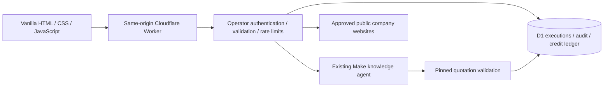

# Make Enterprise Workbench

[](https://github.com/phlppgdfry/make-enterprise-showcase/actions/workflows/validate.yml) [](https://github.com/phlppgdfry/make-enterprise-showcase/actions/workflows/production-health.yml)

A traceable automation showcase by Philippe Godfroy: ask an actual Make knowledge agent, research approved company websites and inspect persistent execution records. The operational application and the synthetic reference laboratory are clearly separated.

[**Open the operational application**](https://make-enterprise-workbench-phlppgdfry.kippieg.chatgpt.site) · [Health](https://make-enterprise-workbench-phlppgdfry.kippieg.chatgpt.site/api/health) · [Acceptance evidence](docs/PRODUCTION-ACCEPTANCE.md) · [Reference lab](https://phlppgdfry.github.io/make-enterprise-showcase/)

## Actual capabilities

| Capability | Operational behavior | Boundary |
| --- | --- | --- |
| Repository knowledge | Browser → authenticated backend → existing Make Repo Kennisagent → validated citations | Seven public documents pinned to `885c72b6a247ef9f9aabe7bc540339888397f403`; answers concern that historical snapshot |
| Company research | Actual HTTPS homepage metadata, robots checks, source excerpts and observation time | Approved domains only; no invented contacts, emails, fit scores or independently verified firmographics |
| Execution ledger | D1 persistence, request IDs, audit events, idempotency and uncertain-state handling | Single operator; seven-day retrieval period; physical retention purge is operator-triggered |
| Credit control | Server-side allocation, provider usage receipts and atomic reconciliation | Existing approved 50-credit allowance; no purchases or automatic model retries |
| Integration inspection | Read-only inspection of the real agent and existing scenarios | Detailed inventory and execution history require operator access |
| CRM | Explicit `crm_unconfigured` error | No configured CRM, no contact writes and no outbound communications |

Seven fresh browser-to-Make acceptance cases passed, with **9.99 actual Make credits reported**. The latest local suite has **110 passing Node tests**, plus the legacy local pattern experiments. These numbers do not establish a security certification or an enterprise SLA. The [acceptance report](docs/PRODUCTION-ACCEPTANCE.md) records exact commits, deployment evidence and remaining prerequisites.

## Architecture



The Worker serves both frontend and API through Sites. Secrets remain server-side. Public visitors can inspect health and capability status; model calls, research, history and maintenance require a separate operator key. The browser holds that key only in tab memory. Model output is rendered as text. A verified quotation proves provenance, not the truth of every claim in an answer.

The original GitHub Pages lab remains available with synthetic support, tenant-scoped knowledge retrieval and deterministic lead scoring. It does not use a model, live research or connected business accounts. Its Node gateway (`scripts/server.js`) is a separate local reference, not the operational backend.

## Local setup

Node.js **22.13+**, preferably Node 24, npm and a full Git clone are required. The build reads knowledge from the pinned historical commit.

```bash
git clone https://github.com/phlppgdfry/make-enterprise-showcase.git
cd make-enterprise-showcase
npm ci
npm run test:all
npm run build:production
npm run start:production
```

Open `http://127.0.0.1:4179`. The local preview has an in-memory SQLite database, the development key `local-preview-only`, and **no Make credentials**. Its data disappears on restart. It can fetch real approved public company websites when network access is available.

For the original synthetic lab, run `npm start` and open `http://127.0.0.1:4173`. `SHOWCASE_API_TOKEN` enables that reference gateway's authenticated fixture endpoints. It is distinct from the hosted operator key.

## Production configuration

| Setting | Purpose |
| --- | --- |
| `MAKE_API_KEY` | Existing authorized Make token; secret runtime storage only |
| `MAKE_ZONE` | Make API region; this deployment uses `eu1.make.com` |
| `OPERATOR_API_KEY` | Independent high-entropy operator bearer secret |
| `RESEARCH_DOMAINS` | Optional approved domains; defaults to `make.com,cloudflare.com,github.com` |
| `DB` | D1 binding provisioned from `production/.openai/hosting.json` |

The owner explicitly approved secure runtime credential storage and at most 50 existing Make credits. No credentials are in source control. The locally generated operator key is in the ignored owner-readable `exports/production-operator-key.txt`; do not publish it. No CRM credential is configured.

## Verification and deployment

```bash
npm run test:all          # 110 Node tests, local experiments and static blueprint audit
npm run format:check     # Production source formatting
npm run build:production # Bundle Worker and public assets
npm run smoke:production # Actual public checks; no metered AI calls
npm audit                # Dependency advisories
```

CI installs locked dependencies, tests, builds, checks formatting and audits dependencies. The public production health workflow runs every six hours and on manual dispatch. Sites publication is performed with authenticated source/archive tooling; a GitHub push alone does not redeploy the Worker. The artifact records its canonical GitHub source commit, which is returned by `/api/health`.

See [deployment, environment setup and rollback](docs/PRODUCTION-DEPLOYMENT.md), [architecture and security boundaries](docs/PRODUCTION-ARCHITECTURE.md), [integration configuration](docs/PRODUCTION-INTEGRATIONS.md), [repository audit](docs/REPOSITORY-AUDIT.md) and [release acceptance](docs/PRODUCTION-ACCEPTANCE.md).

## Existing Make resources

The existing agent is reused; no duplicate agent or scenario was created. Its seven knowledge documents and read-only permissions are preserved. Five existing scenarios were inspected without changing or executing them. The active webhook/datastore example is not a verified DLQ or exactly-once system; inactive support, CRM, ETL and knowledge scenarios remain templates requiring their own configuration.

The older blueprint deployment tooling still defaults to a plan and requires explicit selection and configuration for writes. The incomplete legacy datastore provisioner no longer claims successful schema provisioning. SDK sketches and earlier audit scores remain historical material, not supported production services.

## Limits before real customer operations

CRM integration requires an authorized destination, credentials, sandbox fields and explicit approval for test writes. Research provides self-published website metadata, not a contact discovery service. The agent's snapshot intentionally predates the operational application: use current status/docs for current deployment facts. Physical retention maintenance is manual; continuous customer operations also need scheduled retention, an approved backup/restore process, access governance and operational ownership. Managed D1 point-in-time recovery and a cloud restore drill have not been verified. The showcase is publicly deployed and its working flows are verified; it is not represented as an unrestricted enterprise production system.
