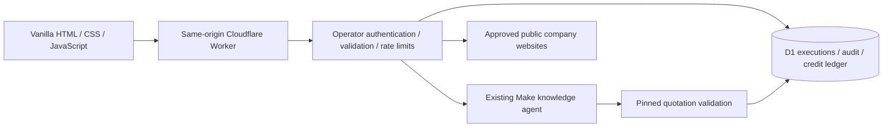

# Make Enterprise Workbench

[](https://github.com/phlppgdfry/make-enterprise-showcase/actions/workflows/validate.yml) [](https://github.com/phlppgdfry/make-enterprise-showcase/actions/workflows/production-health.yml)

A traceable automation showcase by Philippe Godfroy: ask an actual Make knowledge agent, research approved company websites and inspect persistent execution records. The operational application and the synthetic reference laboratory are clearly separated.

[**Open the operational application**](https://make-enterprise-workbench-phlppgdfry.kippieg.chatgpt.site) · [Health](https://make-enterprise-workbench-phlppgdfry.kippieg.chatgpt.site/api/health) · [Current status and remaining work](docs/PRODUCTION-READINESS.md) · [Reference lab](https://phlppgdfry.github.io/make-enterprise-showcase/)

## Version 2.4

Patch 2.4.2 adds authenticated AES-256-GCM backup files with isolated recovery verification ([secure backup CLI](docs/SECURE-BACKUP.md)). A separate operator-only fixed release probe reserves five credits and limits output to 1,200 tokens and one model iteration; normal arbitrary questions still reserve seven. The existing lifetime allowance remains 50. `npm run smoke:agent` and `npm run audit:make` default to plans; explicit `--live` is required for their documented network behavior. The scenario audit is read-only and never executes a scenario.

Version 2.4 adds a server-side HubSpot adapter and a confirmation-gated test-contact workspace. It validates destination readback, handles duplicates without overwriting, retains ambiguous writes for review and rejects customer/unowned records. See [HubSpot setup and verification](docs/HUBSPOT-INTEGRATION.md). Desktop/mobile browser acceptance is now a separate GitHub Actions gate; provider fixtures are distinguished from live integration proof.

Patch 2.4.1 preserves the seven uploaded archive documents and supplies a separate current-release source directly in the agent instructions. Both source versions use immutable GitHub URLs and independent quote validation. Controlled updates refuse unexpected archive IDs/tools and modify only the existing agent's instructions, not its tools or documents. Current operational questions reject historical source versions; the production build preserves and tests source-version metadata. Eight real current-version cases passed. Release model acceptance uses the backend's unchanged credit ledger; it does not bypass the allowance through direct unbudgeted API calls.

Patch 2.3.1 closes expired-idempotency result disclosure, bounds Make response consumption while streaming, and extends free public monitoring to icons, the manifest and protected read endpoints. [Current readiness and prioritized completion criteria](docs/PRODUCTION-READINESS.md) distinguish the finished public showcase from integrations still requiring external configuration.

The interface now includes an interactive architecture explorer, a consistent workflow icon set, SVG/ICO/touch icons, a social preview, sample questions and readable execution receipts with JSON downloads. Exploring a diagram never runs a model. Locking or failing a new login clears private results and prevents late responses from repopulating them.

Operators can download a private, consistent database snapshot and validate it with `npm run backup:verify -- /private/path/backup.json`. The verifier restores into isolated in-memory SQLite, checks the checksum, row counts and credit ledger, and never writes to the hosted database. Managed cloud restore remains unverified. See [version 2.3 verification](docs/RELEASE-2.3.0.md).

## Actual capabilities

| Capability | Operational behavior | Boundary |
| --- | --- | --- |
| Repository knowledge | Browser → authenticated backend → existing Make Repo Kennisagent → validated citations | Seven archive documents at `885c72b6a247ef9f9aabe7bc540339888397f403`, plus a separate current-release source at `21dad08c5aaed036a2057e6f993911d3b051d776`; both use immutable citations |
| Company research | Actual HTTPS homepage metadata, robots checks, source excerpts and observation time | Approved domains only; no invented contacts, emails, fit scores or independently verified firmographics |
| Execution ledger | D1 persistence, request IDs, audit events, idempotency and uncertain-state handling | Single operator; seven-day retrieval period; physical retention purge is operator-triggered |
| Credit control | Server-side allocation, provider usage receipts and atomic reconciliation | Existing approved 50-credit allowance; no purchases or automatic model retries |
| Integration inspection | Read-only inspection of the real agent and existing scenarios | Detailed inventory and execution history require operator access |
| CRM | HubSpot create/find/read/update adapter with confirmed writes and destination readback | Operator-only, application-marked test contacts; no customer writes, messages, enrollment or deletions |

Eight current-version Make acceptance cases passed after the controlled refresh; earlier failures are retained in [current acceptance](docs/PRODUCTION-ACCEPTANCE.md). Lifetime reported verification usage is **46.07/50 credits**, including unsuccessful attempts. A fresh bounded inference with the scoped runtime key passed for 1.91 credits. The remaining 3.93 is below both the five-credit fixed-probe and seven-credit normal allocation, so further new AI requests are blocked pending a new explicit allowance decision; stored answers replay without inference. The latest local suite has **132 passing Node tests and ten desktop/mobile browser checks**, plus the legacy local pattern experiments. Browser provider fixtures do not establish live HubSpot operation, a security certification or an enterprise SLA. [Current readiness](docs/PRODUCTION-READINESS.md) links dated acceptance receipts and remaining prerequisites.

## Architecture



The Worker serves both frontend and API through Sites. Secrets remain server-side. Public visitors can inspect health and capability status; model calls, research, history and maintenance require a separate operator key. The browser holds that key only in tab memory. Model output is rendered as text. A verified quotation proves provenance, not the truth of every claim in an answer.

The original GitHub Pages lab remains available with synthetic support, tenant-scoped knowledge retrieval and deterministic lead scoring. It does not use a model, live research or connected business accounts. Its Node gateway (`scripts/server.js`) is a separate local reference, not the operational backend.

## Local setup

Node.js **22.13+**, preferably Node 24, npm and a full Git clone are required. The build reads seven archive sources and a separate current capability source from their pinned commits.

```bash
git clone https://github.com/phlppgdfry/make-enterprise-showcase.git
cd make-enterprise-showcase
npm ci
npm run test:all
npm run build:production
npm run start:production
```

Open `http://127.0.0.1:4179`. The local preview has an in-memory SQLite database, the development key `local-preview-only`, and **no Make credentials**. Its data disappears on restart. It can fetch real approved public company websites when network access is available.

For the original synthetic lab, run `npm start` and open `http://127.0.0.1:4173`. `SHOWCASE_API_TOKEN` enables that reference gateway's authenticated fixture endpoints. It is distinct from the hosted operator key.

## Production configuration

| Setting | Purpose |
| --- | --- |
| `MAKE_API_KEY` | Existing authorized Make token; secret runtime storage only |
| `MAKE_ZONE` | Make API region; this deployment uses `eu1.make.com` |
| `OPERATOR_API_KEY` | Independent high-entropy operator bearer secret |
| `RESEARCH_DOMAINS` | Optional approved domains; defaults to `make.com,cloudflare.com,github.com` |
| `DB` | D1 binding provisioned from `production/.openai/hosting.json` |
| `HUBSPOT_ACCESS_TOKEN` | Approved contact-only HubSpot key; encrypted runtime secret |
| `HUBSPOT_PORTAL_ID` | Selected account, stored in runtime configuration |
| `CRM_MODE` | Must be `test-only`; customer operations are not enabled |

The owner approved secure runtime storage, the contact-only HubSpot key and at most 50 existing Make credits. No credentials are in source control. The operator key remains in ignored, owner-readable `exports/production-operator-key.txt`. HubSpot credentials are not provided to local preview or CI.

## Verification and deployment

```bash
npm run test:all          # 132 Node tests, local experiments and static blueprint audit
npm run test:browser      # 10 desktop/mobile UI checks with local provider fixtures
npm run format:check     # Production source formatting
npm run build:production # Bundle Worker and public assets
npm run smoke:production # Actual public checks; no metered AI calls
npm audit                # Dependency advisories
```

CI installs locked dependencies, tests, builds, checks formatting and audits dependencies. The public production health workflow runs every six hours and on manual dispatch. Sites publication is performed with authenticated source/archive tooling; a GitHub push alone does not redeploy the Worker. The artifact records its canonical GitHub source commit, which is returned by `/api/health`.

See [deployment, environment setup and rollback](docs/PRODUCTION-DEPLOYMENT.md), [architecture and security boundaries](docs/PRODUCTION-ARCHITECTURE.md), [integration configuration](docs/PRODUCTION-INTEGRATIONS.md), [repository audit](docs/REPOSITORY-AUDIT.md) and [release acceptance](docs/PRODUCTION-ACCEPTANCE.md).

## Existing Make resources

The existing agent is reused; no duplicate agent or scenario was created. Its seven knowledge documents and read-only permissions are preserved. Five existing scenarios were inspected without changing or executing them. The active webhook/datastore example is not a verified DLQ or exactly-once system; inactive support, CRM, ETL and knowledge scenarios remain templates requiring their own configuration.

The older blueprint deployment tooling still defaults to a plan and requires explicit selection and configuration for writes. The incomplete legacy datastore provisioner no longer claims successful schema provisioning. SDK sketches and earlier audit scores remain historical material, not supported production services.

## Limits before real customer operations

CRM is restricted to confirmed, application-marked test contacts in the authorized HubSpot account. Customer operations require individual access governance and an approved business schema. Research provides self-published website metadata, not contact discovery. The seven uploaded documents are historical; a separate immutable release addendum supplies current capabilities. Live health/status remain authoritative for runtime identity. The dedicated Make token is organization-bound with agent read/write and scenario read only; agent-write is required by Make for inference and is broader than the agent’s read-only application role. Physical retention remains manual at the owner’s request. Continuous customer operations also need approved backup custody/recovery and operational ownership. Managed D1 point-in-time recovery and a cloud restore drill remain unverified; this showcase is not represented as an unrestricted enterprise production system.
