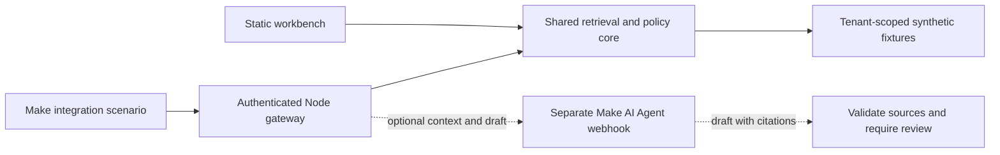

# Make Agent Workbench

[](https://github.com/phlppgdfry/make-enterprise-showcase/actions/workflows/validate.yml)

**Evidence-based support, knowledge retrieval and lead qualification.** An executable automation reference by Philippe Godfroy, with a shared browser/API policy core and an optional Make AI Agent drafting adapter.

[Open the interactive workbench](https://phlppgdfry.github.io/make-enterprise-showcase/) · [Make AI Agents setup](docs/MAKE-AI-AGENTS.md) · [Current verification](docs/VERIFICATION.md)

## Try it

Requires Node.js 22 or newer. No package installation, model key or Make login is needed for the local reference flows.

```bash
git clone https://github.com/phlppgdfry/make-enterprise-showcase.git
cd make-enterprise-showcase
npm test
npm start
```

Open **http://127.0.0.1:4173**. Run a support request, change workspaces to test source isolation, or qualify a sample lead. Inspect the evidence, execution trace and decision; export the result as JSON.

The browser demo uses **synthetic fixtures and deterministic tools**, not an LLM, live web research or your connected accounts. It executes the same code as the API. There are no external writes, sent emails or automatic refunds.

## What is implemented

| Workflow | Executable behavior | Deliberate boundary |
| --- | --- | --- |
| Support triage | Tenant-scoped customer lookup and knowledge retrieval; response draft; explicit review reasons | Every refund, cancellation or plan change requires review; no mutation tools |
| Knowledge search | Filter by tenant before lexical ranking; extract source text with document IDs | No matching evidence → insufficient context; no fabricated vector-search claims |
| Lead qualification | Published ICP rules, per-criterion points, source-backed synthetic firmographics and outreach draft | Unknown or incomplete company → research needed and null score; no invented facts or email sending |
| Make agent adapter | One authenticated draft request; typed output checks; exact source-quote validation; bounded timeout | Every model draft requires review; rejected output fails closed |

A source quotation proves provenance, not that all claims in a model draft follow from it. No self-reported confidence score is used as permission to act.

## Architecture



- [Shared core](docs/lib/agent-core.js): retrieval, support policy, ICP scoring and candidate validation.
- [Reference data](docs/data/reference.json): explicitly synthetic documents, customers and company profiles.
- [Gateway](scripts/server.js): token authentication, trusted tenant binding, input limits and optional agent adapter.
- [Agent instructions and output contract](agents): support/knowledge prompts, research design notes and JSON Schema.
- [Integration guide](docs/MAKE-AI-AGENTS.md): native Make AI Agents setup, data contracts, error behavior and production gaps.

## Make templates and cloud status

| Scenario | Repository status |
| --- | --- |
| [01 — Support triage](blueprints/01-ai-agent-autonomous-triage) | Updated gateway integration template; account configuration and Make schema verification required |
| [02 — Webhook ingestion](blueprints/02-idempotent-webhook-dlq-engine) | Historical three-module cloud reference; active state observed on 2026-11-04, no new execution claimed |
| [03 — CRM/billing](blueprints/03-bidirectional-crm-billing-reconciliation) | Historical design / partial integration template; not a verified bidirectional sync |
| [04 — ETL](blueprints/04-self-healing-etl-rate-limit-governor) | Historical design / partial integration template; no implemented distributed rate limiter |
| [05 — Knowledge retrieval](blueprints/05-rag-vector-knowledge-dispatcher) | Updated gateway integration template; lexical fixture retrieval, not a Pinecone implementation |
| [06 — Lead qualification](blueprints/06-evidence-based-lead-qualification) | New gateway integration template with an auditable fixture scorer |

The Make account was inspected **read-only** for this update. Scenario 02 was active; 01/03/04/05 were inactive. The default Make AI Provider connection was present. No cloud agents were provisioned, activated or executed. Publishing this repo does not deploy the Node API or activate Make scenarios.

## Authenticated API

Set `SHOWCASE_API_TOKEN` and optionally `SHOWCASE_TENANT_ID` before `npm start`. The API is disabled without a token; the browser demo remains usable. Each gateway instance binds one tenant. The server uses synthetic data until you implement and test a real data adapter.

| Endpoint | JSON input | Output |
| --- | --- | --- |
| `POST /api/support` | `query`, `customerId`, optional `action`, optional numeric `amount` | Draft, citations, review reasons, trace |
| `POST /api/knowledge` | `query` | Extracted answer or insufficient context |
| `POST /api/leads` | `domain` | ICP score/breakdown or research needed |
| `GET /health` | None | Process status, mode and fixture storage label |

Send `Authorization: Bearer <SHOWCASE_API_TOKEN>` and `Content-Type: application/json`. An input tenant that differs from the configured tenant is rejected. Bind the loopback service through an authenticated HTTPS proxy for remote use. GitHub Pages hosts the static workbench only.

To enable model-assisted drafting, configure `MAKE_AGENT_URL` and `MAKE_AGENT_TOKEN` using the [native Make agent guide](docs/MAKE-AI-AGENTS.md). The default remains extractive, deterministic reference behavior.

## Verification and operations

```bash
npm test          # Structural blueprint checks + regression/API tests
npm run test:all  # Tests, local pattern experiments and static audit
npm run simulate  # Execute six actual fixture requests and print their trace
npm run test:e2e  # Real local HTTP journey across all three workflows
npm run deploy    # Offline readiness plan; no cloud changes by default
npm run probe     # Dry run; no network requests by default
```

`npm run deploy -- --apply --scenario=<directory> --id=<existing-id> --blueprint-file=/private/path/configured.json` only permits a selected, inactive scenario with explicit credentials/team, resolved placeholders, a backup and a concurrency version. The private file lets credentials and tenant-specific configuration stay outside git; the saved module order, routes, filters and mapped values are checked after saving. Template module schemas must still be verified in Make. Live probes require one explicit webhook, an explicit payload file and `--live`. No bulk webhook broadcast or simulated healthy response is used.

## Scope and historical material

Local regression tests establish only the tested behavior. They do not certify SOC 2, ISO 27001, GDPR compliance, exactly-once delivery or an enterprise SLA. This reference has no persistent conversation store, durable task queue, production rate limiter, semantic vector index or live company research adapter.

Earlier audits, SDK examples and case-study designs remain as **historical material**, with notices identifying their limits. Read [current verification](docs/VERIFICATION.md) and the individual scenario README before relying on a claim. The earlier 98% architecture score was a heuristic over labels and module presence, not a production readiness assessment; that scoring output has been removed.

MIT License. Built by Philippe Godfroy.
