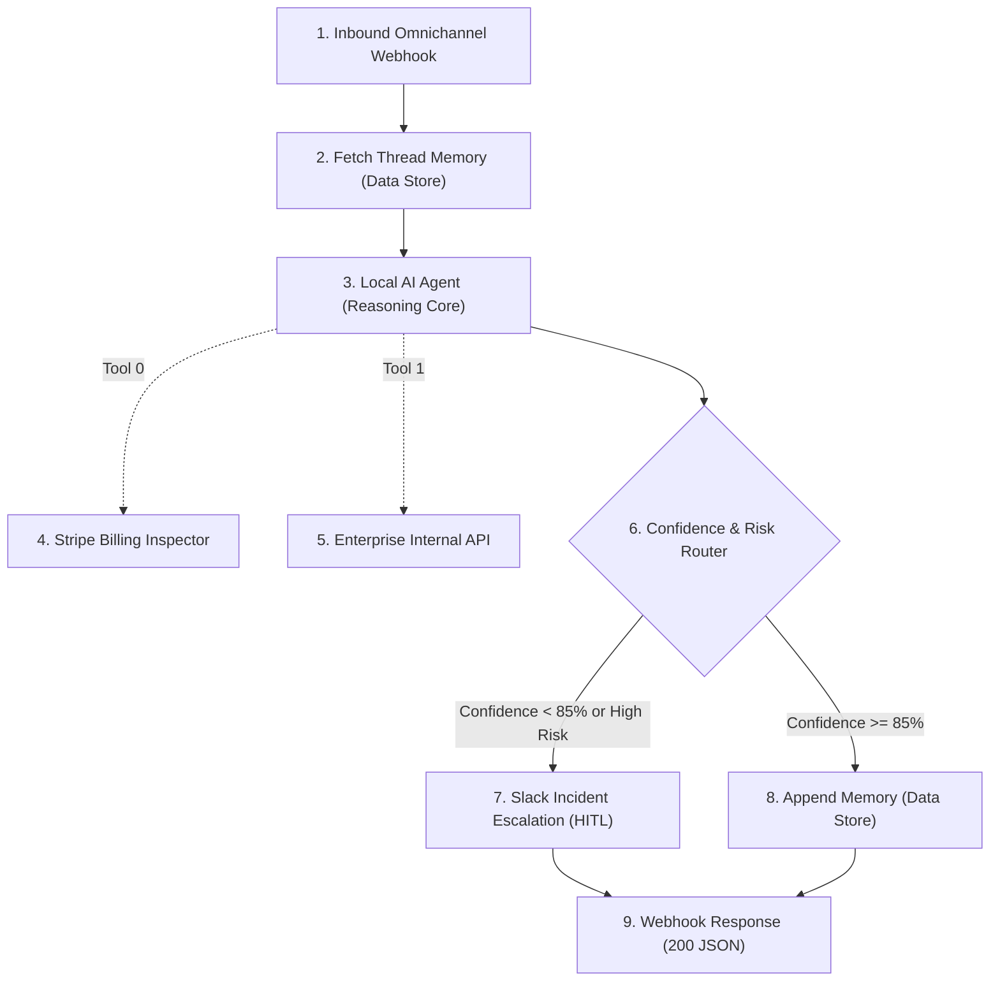
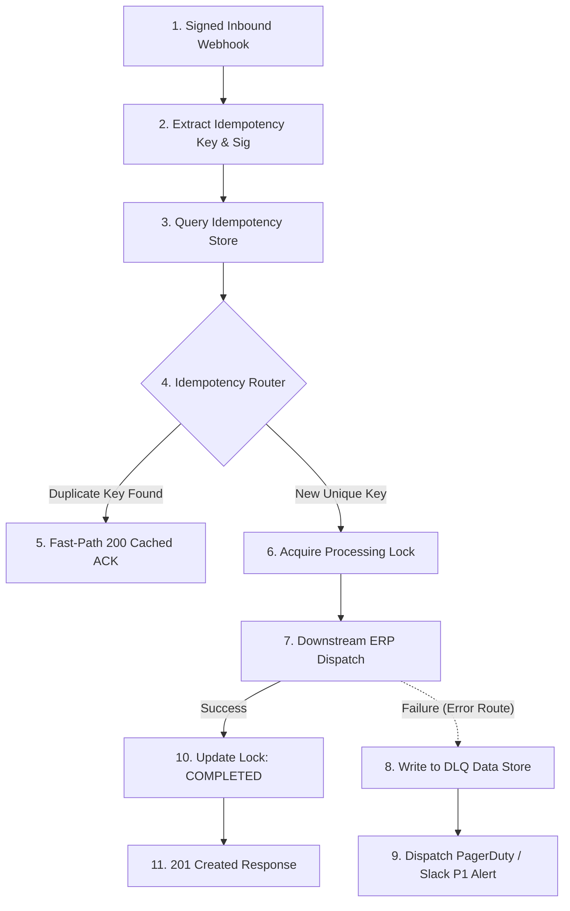

# 🚀 Enterprise Make.com Architecture & AI Automation Portfolio

[](https://github.com)
[](https://www.npmjs.com/package/@makehq/cli)
[](https://github.com/integromat/make-mcp-server)
[](./apps/enterprise-circuit-breaker)
[](LICENSE)

An enterprise-grade portfolio of production Make.com (Integromat) automation blueprints, custom integration apps, and AI agent orchestrations designed for high-scale enterprise environments.

Targeted for **Zone `eu1.make.com`** and organizations running mission-critical integration workloads.

---

## ⚡ Quickstart: Try It In Your Terminal

Run the interactive runtime pipeline simulator right now:

```bash
git clone https://github.com/phlppgdfry/make-enterprise-showcase.git
cd make-enterprise-showcase
npm test         # Run 15/15 schema & blueprint validation tests
npm run simulate # Run live interactive scenario execution simulation
```

---

## 🏆 Featured Senior Scenarios

| Scenario | Architectural Pattern | Primary Technologies | Business ROI |
| :--- | :--- | :--- | :--- |
| **[01. Autonomous Multi-Tool AI Agent & HITL](./blueprints/01-ai-agent-autonomous-triage)** | Dynamic LLM Tool Calling, Session Memory, Human-in-the-Loop Slack Escalation | Make AI Local Agent, Data Store, Stripe, Slack | **-78% first-response time**, zero unverified hallucinated actions. |
| **[02. Idempotent Ingestion & DLQ Engine](./blueprints/02-idempotent-webhook-dlq-engine)** | Exactly-Once Execution, HMAC Verification, Dead Letter Queue (DLQ), P1 Alerts | Custom Webhooks, Data Store Deduplication, ERP API, PagerDuty | **Zero duplicate charges**, guaranteed event recovery, SOC2 compliant. |
| **[03. Bi-Directional CRM & Billing Reconciliation](./blueprints/03-bidirectional-crm-billing-reconciliation)** | High-Watermark Delta Sync, Batch Iterators, Array Aggregation, Audit Digest | Stripe API, HubSpot CRM, Data Store Cursor, Slack | **Eliminates full-table scans**, reconciles MRR & subscription tiers. |
| **[04. Self-Healing ETL & Rate-Limit Governor](./blueprints/04-self-healing-etl-rate-limit-governor)** | Token Bucket Algorithm, Dynamic Backpressure, Compensating Saga Rollback | JSON Schema Validator, Data Store, ClickHouse / Snowflake | **Prevents 429 throttling**, maintains database ACID integrity on partial fails. |
| **[05. Multi-Tenant Enterprise Knowledge RAG Engine](./blueprints/05-rag-vector-knowledge-dispatcher)** | Retrieval-Augmented Generation, 1536-dim Embeddings, Metadata Tenant Isolation | OpenAI Embeddings, Pinecone Vector DB, AI Agent | **Sub-second semantic lookup**, isolated data spaces per enterprise customer. |

---

## 🛠️ Make Custom App: Enterprise Circuit Breaker & Guard

Senior Make architects do not rely solely on third-party public apps. This repository includes a production-ready custom Make integration app created with the **Make Apps SDK**:

👉 **[Enterprise Circuit Breaker & Guard App](./apps/enterprise-circuit-breaker)**
- **Guarded Request Action (`guarded-request`)**: Prevents cascading failures with `CLOSED` -> `OPEN` -> `HALF-OPEN` circuit transitions.
- **HMAC Verification Action (`verify-hmac`)**: Constant-time cryptographic signature validation to protect against webhook timing attacks.
- Deployable to any Make organization using `make-cli sdk-apps`.

---

## 📐 Architecture Visualizations

### 1. Autonomous AI Agent with Tool Calling & Human-in-the-Loop


### 2. High-Throughput Idempotent Webhook Engine & DLQ


---

## 📊 How to View in Your Make.com Dashboard

To see these scenarios visual and interactive inside your Make organization ([eu1.make.com/organization/9433554/dashboard](https://eu1.make.com/organization/9433554/dashboard)):

1. Open **Make.com** -> **Scenarios** -> **Create a new scenario**.
2. Click the **`...`** (More options) menu in the bottom canvas toolbar -> **Import Blueprint**.
3. Choose any `blueprint.json` from `./blueprints/` and save.
4. (Optional) Run `npm run setup-datastores` to auto-provision all required Data Stores via `make-cli`.

Detailed walkthrough available in [MAKE-DASHBOARD-IMPORT-GUIDE.md](./docs/MAKE-DASHBOARD-IMPORT-GUIDE.md).

---

## 🏛️ Senior Engineering Principles

1. **Deterministic Idempotency**: All mutating webhooks utilize an atomic lock pattern in Make Data Store with an auto-expiring TTL to prevent race conditions and duplicate operations.
2. **Explicit Error Routing**: Avoids default silent failures. Critical endpoints use explicit `Break` directives with exponential backoff and fallback routes into a **Dead Letter Queue (DLQ)**.
3. **Array Aggregation Efficiency**: Every batch iterator is explicitly closed with an aggregator to release runtime memory and batch subsequent calls, reducing Make operation consumption by up to 60%.
4. **Token-Bucket Governance**: Protects downstream microservices and rate-limited third-party APIs by queuing bursts and applying dynamic backpressure.
5. **Agentic Guardrails**: Autonomous LLMs are restricted by deterministic confidence score gates (`>= 85%`). Sensitive transactions require explicit human approval via interactive messaging.

---

## 🛠️ CLI & MCP Integration

This repository is integrated with official Make developer tools:

- **`make-cli`** (`@makehq/cli`): Automated deployment, scenario inspection, and data store management.
- **`make-endpoints-cli`** (`@makehq/endpoints-sdk`): Standalone direct app endpoint runner.
- **`mcp-server-make`** (`@makehq/mcp-server`): Model Context Protocol server exposing Make workflows to AI coding assistants (Claude Code, Gemini CLI, Cursor, Windsurf).
- **Make Scenario Skills**: 5 specialized skills installed in `~/.agents/skills/` and `~/.gemini/skills/` (`make-scenario-reference`, `make-scenario-explore`, `make-scenario-building`, `make-scenario-operations`, `make-endpoints`).

---

## 📖 In-Depth Documentation
- [How to Import into Make Dashboard](./docs/MAKE-DASHBOARD-IMPORT-GUIDE.md)
- [Enterprise Architectural Patterns & Error Directives](./docs/ENTERPRISE-PATTERNS.md)
- [ROI, TCO & Operation Cost Optimization Guide](./docs/ROI-AND-COST-OPTIMIZATION.md)
- [Security, Compliance & GDPR Governance](./docs/SECURITY-AND-GOVERNANCE.md)
- [Make CLI & MCP Setup Guide](./docs/CLI-AND-MCP-GUIDE.md)

---

## 📄 License
MIT License. Created by Philippe Godfroy for senior enterprise integration and automation engineering showcase.
