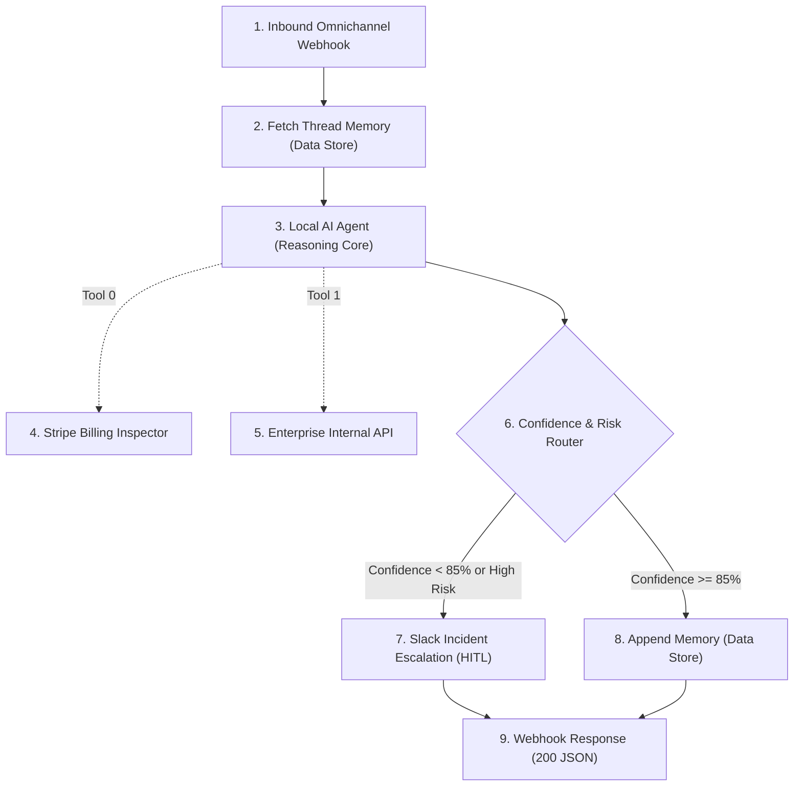

# Scenario 01: Autonomous Multi-Tool AI Agent & Human-in-the-Loop Orchestrator

## Architecture Overview
An enterprise AI Agent orchestrator built in Make.com. It receives customer inbound queries via an API webhook, recovers context and multi-turn state from a persistent Data Store, invokes a local LLM agent with function calling (tools), and evaluates confidence before executing sensitive changes or escalating to human operators in Slack.

## Senior Architectural Patterns Implemented
1. **Dynamic Tool Calling**: Decouples business logic into discrete Make tool modules invoked autonomously by the agent.
2. **Stateful Conversation Window**: Overcomes LLM statelessness by managing session threads in Make Data Stores with timestamped keys.
3. **Deterministic Guardrails**: Rejects hallucinated resolutions by enforcing a minimum confidence threshold (`>= 85%`) before committing changes.
4. **Human-in-the-Loop (HITL) Failover**: Automatically freezes execution and redirects edge cases to Slack operations channels with interactive deep-links.

## Files
- `blueprint.json`: Native Make.com UI importable blueprint.
- `scenario-create.json`: API & MCP scenario manifest for automated provisioning via `make-cli` or `@makehq/mcp-server`.
