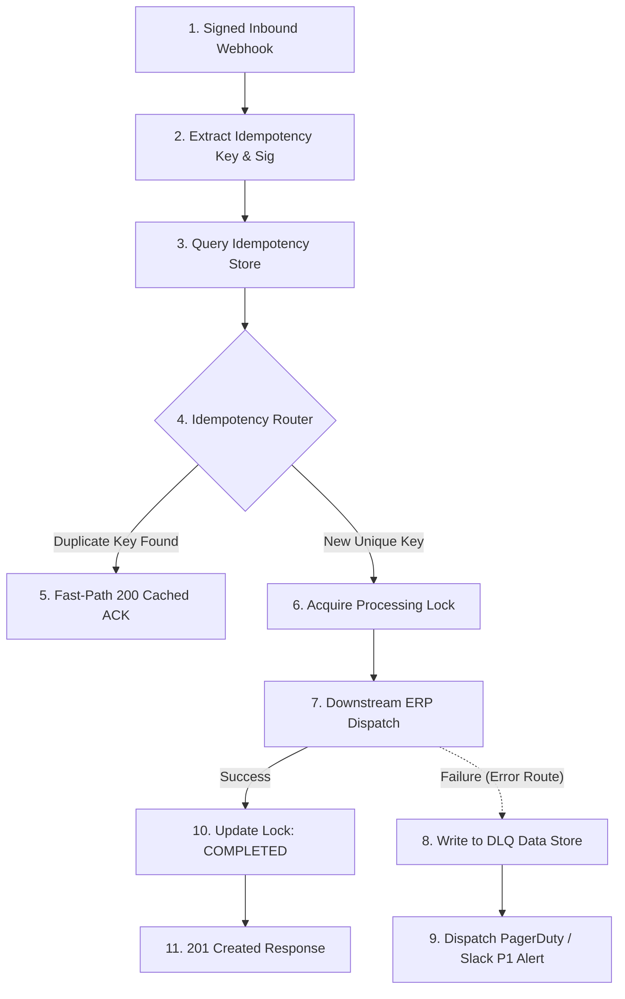

# Scenario 02: High-Throughput Idempotent Webhook Engine & Dead Letter Queue (DLQ)

## Architecture Overview
An enterprise webhook processing engine engineered to guarantee exactly-once execution semantics, eliminate duplicate charges or records, and isolate poisonous payloads into a dedicated Dead Letter Queue (DLQ) without crashing the pipeline.

## Senior Architectural Patterns Implemented
1. **Idempotency Guard**: Eliminates race conditions and duplicate operations using unique event keys (`X-Idempotency-Key` or payload hash) checked atomically against a Make Data Store.
2. **Two-Phase Lock Lifecycle**: State transitions from `PROCESSING` -> `COMPLETED`, preventing duplicate downstream calls if upstream retries occur while processing.
3. **Dead Letter Queue (DLQ)**: Failed payloads are intercepted by an error handler, recorded with the full stack trace in a DLQ Data Store, and flagged for manual or automated replay.
4. **Zero-Loss Guarantee**: The scenario never drops an event, satisfying SOC2 / ISO27001 data integrity standards.

## Files
- `blueprint.json`: Native Make.com UI importable blueprint.
- `scenario-create.json`: API & MCP scenario manifest.
