# Scenario 03: Bi-Directional CRM & Billing Differential Sync Engine

## Architecture Overview
An enterprise batch synchronization pipeline syncing Stripe customer subscription changes and MRR to HubSpot CRM contacts with high-watermark delta cursor tracking and aggregated audit reporting.

```mermaid
flowchart LR
    CRON["1. Scheduled Cron (15m)"] --> GET_CURSOR["2. Read Timestamp Cursor"]
    GET_CURSOR --> FETCH_STRIPE["3. Stripe Search (updated > cursor)"]
    FETCH_STRIPE --> ITERATOR["4. Iterator (Batch Unroll)"]
    ITERATOR --> UPSERT_CRM["5. HubSpot Contact Upsert"]
    UPSERT_CRM --> AGGREGATOR["6. Array Aggregator"]
    AGGREGATOR --> SAVE_CURSOR["7. Commit New Timestamp Cursor"]
    SAVE_CURSOR --> SLACK_DIGEST["8. Post Ops Audit Digest"]
```

## Senior Architectural Patterns Implemented
1. **Delta / High-Watermark Synchronization**: Avoids expensive and redundant full-table scans by querying only records updated after the last checkpoint (`updated > cursor`).
2. **Iterator + Array Aggregator Pairing**: Processes items iteratively to isolate record-level errors, then collapses downstream operations into a single aggregated rollup.
3. **Sequential Execution Guard**: Configured with `sequential: true` in Make scenario settings to eliminate race conditions between concurrent sync cycles.
4. **Drift Detection & Reconciliation Log**: Automatically reports counts and audit metrics to internal channels for continuous monitoring.

## Files
- `blueprint.json`: Native Make.com UI importable blueprint.
- `scenario-create.json`: API & MCP scenario manifest.
