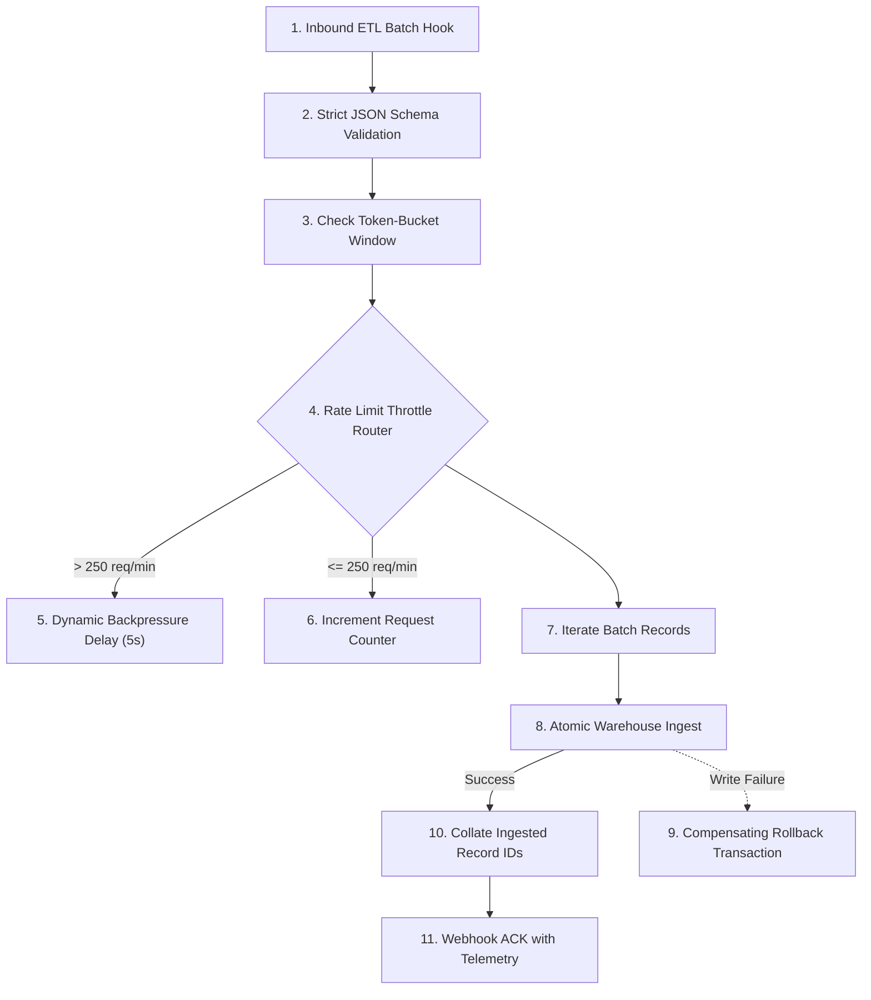

# Scenario 04: Self-Healing ETL Pipeline with Rate-Limit Governor & Transaction Rollback

## Architecture Overview
An enterprise ETL pipeline with an in-memory token-bucket governor designed to protect downstream services from rate-limit exhaustion (`429 Too Many Requests`), accompanied by compensating rollback transactions on partial batch write failures.

## Senior Architectural Patterns Implemented
1. **Dynamic Backpressure & Token Bucket**: Implements a sliding 1-minute window in Make Data Store to throttle incoming bursts and avoid downstream API rate limiting.
2. **Strict Schema Gate**: Enforces JSON validation prior to iteration to guarantee bad records fail early before mutating databases.
3. **Saga / Compensating Transaction**: Triggers an automated rollback webhook whenever a single record in a multi-record transaction fails, preserving database consistency.
4. **Telemetry Feedback**: Returns real-time execution statistics (batch ID, counts, execution latency) in the synchronous webhook acknowledgment.

## Files
- `blueprint.json`: Native Make.com UI importable blueprint.
- `scenario-create.json`: API & MCP scenario manifest.
