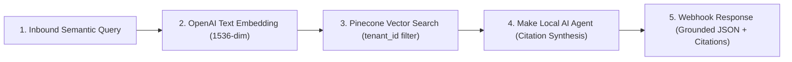

# Scenario 05: Multi-Tenant Enterprise Knowledge RAG Engine

## Architecture Overview
A production-grade Retrieval-Augmented Generation (RAG) pipeline built directly in Make.com. It receives customer semantic search queries, generates OpenAI embeddings, conducts namespace-filtered vector similarity search on Pinecone, and synthesizes grounded answers with strict citation requirements.

## Senior Architectural Patterns Implemented
1. **Multi-Tenant Vector Isolation**: Injects `tenant_id` metadata filters directly into the Pinecone query to prevent cross-tenant data leakage.
2. **Embedding Pipeline Orchestration**: Calls OpenAI `text-embedding-3-small` dynamically and extracts the embedding vector for near real-time vector search.
3. **Strict Grounding & Anti-Hallucination Guardrail**: The system prompt instructs the agent to return `INSUFFICIENT_CONTEXT` if top vector matches do not satisfy the user query.
4. **Structured Citation Payloads**: Guarantees traceable output by returning document IDs and confidence metrics in the synchronous API response.

## Files
- `blueprint.json`: Native Make.com UI importable blueprint.
- `scenario-create.json`: API & MCP scenario manifest.
