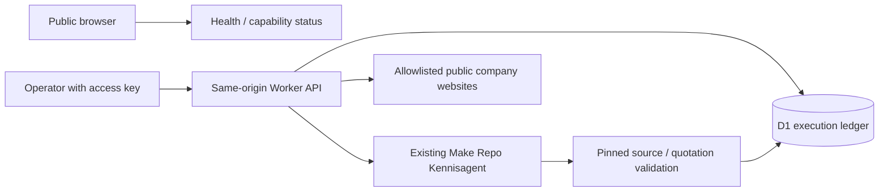

# Operational architecture

The public operational application is a dependency-light Cloudflare Worker hosted by Sites. It serves vanilla HTML/CSS/JavaScript and same-origin JSON APIs. GitHub Pages remains the explicitly synthetic reference laboratory. No fixtures are used to produce operational API results.

## Security boundaries

Public GET health/status routes expose capability metadata only. Executions, results, history, Make inventory inspection and retention maintenance require a separate 256-bit operator bearer key. The UI keeps it in tab memory. There are no public CRM writes, outbound messages or browser-visible Make credentials. This is a single-operator showcase, not a multi-tenant SaaS or enterprise SSO product.

Unsafe cross-origin requests are denied. JSON requests have a 16 KB streamed size limit and strict field validation. A database-backed per-IP/minute limit caps API requests at 60; the trusted Cloudflare client IP header is used on the hosted runtime. CSP permits same-origin application scripts and a fresh cryptographic response nonce for Cloudflare’s injected bot-detection script, without `unsafe-inline`. Third-party resources, framing and cross-origin API connections remain blocked. This follows [Cloudflare’s nonce guidance](https://developers.cloudflare.com/bots/get-started/bot-fight-mode/#javascript-detections). Errors and logs omit upstream response bodies, credentials and user inputs. Correlation IDs are generated server-side.

## Executions and persistence

D1 migrations in `production/drizzle/` create executions, a lifetime credit ledger, audit events, rate-limit buckets, research records and integration inspection cache. Unique operator/workflow/idempotency keys prevent repeated upstream writes/calls. Different input under the same key produces 409. A request claims its record before contacting the provider. No automatic model retries occur. A timeout after dispatch is `uncertain`, keeps its allocation and requires inspection; retrying the same key returns its original record. There is deliberately no background job queue or assertion of exactly-once delivery to Make.

Questions and results may contain operator-entered information: use public repository questions only. Retrieval hides expired records after seven days. Protected `POST /api/maintenance/retention` physically deletes expired execution/audit/research data and old rate buckets. It must be called by an operator or an authorized scheduler; automatic cleanup was explicitly deferred by the owner. An optional maintenance-only credential is supported by the code but is not configured: it cannot read history, reconcile credits or execute workflows. Integration metadata remains until the next inspection. The global credit allowance is never reset by retention. Provider-side retention and platform backups follow those providers' policies; application deletion is not a provider erasure request.

## Make agent

The server calls the officially supported `/api/v2/ai-agents/v1/agents/{id}/run?teamId=...` API using the existing read-only agent, not a new scenario. Before each metered call it verifies identity, seven documents, no scenario/MCP tools, model `medium`, output token limit and pinned commit in the instructions. Knowledge remains at commit `885c72b6a247ef9f9aabe7bc540339888397f403`. Current-site facts must be read from current docs/status, not inferred from this older snapshot. Citations must have the exact allowlisted commit URL and a quotation present in that source. This proves provenance, not semantic entailment of every model claim.

The approved 50 existing-credit verification allowance is conservatively allocated as 7 credits per dispatch, permitting at most seven unreconciled metered dispatches (49 allocated credits). Actual reported centicredits are recorded separately. An authenticated operator can reconcile final provider receipts atomically with `POST /api/budget/reconcile`. This releases only the difference between an allocation and known reported usage; unknown charges retain their allocation. The 50-credit limit is unchanged, and repeated reconciliation or retention never resets lifetime spending. This application counter is not an account-wide Make billing cap; other account activity is outside it. Model pricing and provider maximum output limits must be reviewed before any future allowance increase. Unknown provider usage remains unknown, never zero.

## Research and CRM

Research fetches actual HTTPS homepage metadata from three configured organizational domains. Redirects stay on the exact approved domain or its `www` host. Robots failures fail closed (404 is treated as no published policy). Content and redirect counts are bounded. HTML is parsed with parse5; output includes observation time, title/description excerpts and the source URL. Existing domain records are reused for seven days. Metadata is self-published evidence, not independently corroborated firmographics, verified contact information or AI lead scoring. No inferred email addresses or personal contacts are produced.

CRM is explicitly unconfigured. Protected CRM routes return 503 and never pretend to create a contact. A real CRM adapter requires an authorized destination, credentials, sandbox schema and specific approval for test writes. Existing inactive HubSpot scenario 8199351 has no working account connection. It is preserved.

## Existing Make scenarios

Inventory inspection reads scenario metadata; it never edits or executes existing scenarios. Active scenario 8199349 is a three-module webhook → datastore → response flow. Its historical DLQ/idempotency name exceeds its actual safeguards. It is not used by this application: its fallback fixed order ID could overwrite a record. Other scenarios remain inactive/unlinked templates. Operational workflows here are the real repository-agent call and company-source research, not a claim that all historical blueprints are production integrations.
