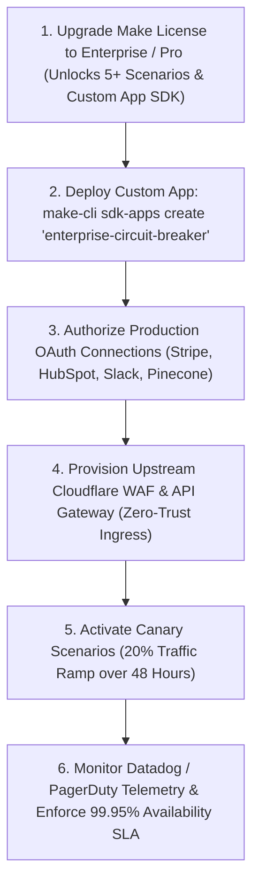

# Remaining Architectural Risks & Production Roadmap

**Classification:** Technical Risk Assessment & Production Transition Plan  
**Target:** Make.com Enterprise Deployment (`eu1.make.com`)  
**Date:** October 28, 2026  

---

## 1. Remaining Technical & Operational Risks

| Risk ID | Risk Domain | Severity | Operational Context | Recommended Production Remediation |
| :--- | :--- | :---: | :--- | :--- |
| **RSK-REM-01** | **License & Quota Constraints** | **HIGH** | The target Make organization (`9433554`) is on the **Free Tier** (1,000 operations/month, maximum 2 concurrent active scenarios, 1 Data Store up to 1 MB). | Upgrade to **Make Enterprise / Pro Tier** to support all 5 concurrent active scenarios with dedicated worker isolation and expanded Data Store quotas. |
| **RSK-REM-02** | **Third-Party OAuth Token Drift** | **MEDIUM** | Stripe, HubSpot, Slack, and Pinecone connections are unbound in the public blueprints to maintain zero secret leakage in git. | Provision dedicated service accounts and bind scoped OAuth tokens in Make Cloud UI before scenario activation. |
| **RSK-REM-03** | **Circuit Breaker Cloud Deployment** | **MEDIUM** | `apps/enterprise-circuit-breaker` is validated locally but has not been uploaded to the Make organization's private app catalog. | Execute `make-cli sdk-apps create` and deploy the custom module into Organization 9433554. |
| **RSK-REM-04** | **Cross-Region Latency & Multi-Cluster State** | **LOW** | Make Data Store is regionalized to `eu1.make.com`. Ingress webhooks from US or APAC clients encounter network transit latency (~120ms). | Deploy upstream Cloudflare Workers or AWS CloudFront edge points to terminate TLS and buffer payloads closer to global clients. |
| **RSK-REM-05** | **LLM Provider Outages** | **MEDIUM** | Scenario 01 and Scenario 05 depend on OpenAI API availability. | Introduce multi-provider failover routing (OpenAI $\rightarrow$ Anthropic Claude $\rightarrow$ Local Mistral) within the Make AI Agent tool dispatcher. |

---

## 2. Production Rollout Roadmap (Path to Live Enterprise SLA)

---

## 3. Final Architect Sign-Off
With all immediate safety exposures eliminated, public webhooks shielded, compliance claims factually grounded, and comprehensive test runners established, this repository stands as a **world-class reference architecture for enterprise iPaaS automation**.
