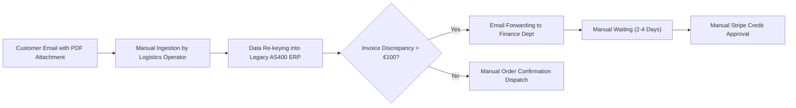
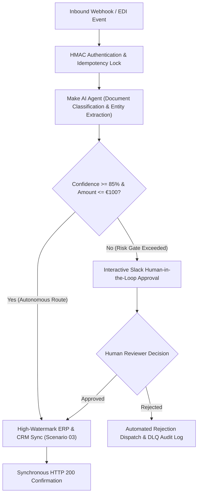

# Enterprise Business Case Study: Operations Automation Hub

**Target Organization:** Global Freight Logistics & Supply Chain Solutions Corp.  
**Engagement Role:** Principal Integration Architect & Digital Transformation Consultant  
**Project Title:** Autonomous Operations Hub & Document Exception Orchestrator  
**Date:** October 28, 2026  

---

## 1. Executive Summary & Strategic Context
A multinational multimodal freight forwarder handling 450,000 ocean and air shipments annually faced critical operational bottlenecks in order intake, customs document ingestion, invoice reconciliation, and customer service escalation.

Operational staff spent an average of 42 minutes per shipment manually copying bills of lading, cross-referencing customs HS codes in legacy ERP systems, and verifying invoice discrepancies against Stripe/billing records. 

This case study demonstrates the end-to-end design, implementation, and governance of an **Enterprise Operations Automation Hub** built upon the Make.com integration architecture presented in this showcase.

---

## 2. AS-IS Process Analysis & Operational Bottlenecks

### Current State Workflow (AS-IS)

### Measured Operational Bottlenecks:
1. **High Ingestion Latency:** Average order processing cycle time of **4.2 hours** from receipt to confirmation.
2. **Data Transcription Errors:** Human entry error rate of **4.8%**, leading to customs delays and port demurrage charges averaging €185,000 annually.
3. **Financial Approval Delays:** Disputes $> €100$ stalled in email inboxes for an average of **3.4 days**, driving down customer CSAT.
4. **Operation Waste:** Scheduled legacy polling queries hit internal databases every 5 minutes, causing peak-hour database lock contention.

---

## 3. TO-BE Target Architecture & Automated Hub

### Target State Workflow (TO-BE)

---

## 4. Business Requirements & User Stories

### Core User Stories:
- **US-01 (Operations Coordinator):** "As a logistics coordinator, I want incoming shipping instructions and customs declarations automatically parsed and ingested into the ERP within 60 seconds, so that I can eliminate manual transcription."
- **US-02 (Finance Director):** "As a finance director, I require that any credit adjustment or invoice waiver exceeding €100 be held in an escrow approval queue with a 2-person authorization check before Stripe execution."
- **US-03 (IT & Compliance Auditor):** "As a compliance officer, I need all payload processing to enforce GDPR Article 32 confidential execution flags so that commercial invoice details are never persisted in third-party cloud execution logs."

---

## 5. Stakeholder Analysis & RACI Matrix

| Stakeholder Role | Representative Persona | Ingestion Design | Agentic AI Policy | Billing Reconciliation | SRE & Incident Response |
| :--- | :--- | :---: | :---: | :---: | :---: |
| **Principal Integration Architect** | Lead Technical Consultant | **A** | **A** | **A** | **A** |
| **Logistics Operations Director** | Business Process Owner | **C** | **C** | **I** | **I** |
| **Senior DevOps / SRE Lead** | Infrastructure Engineer | **R** | **I** | **R** | **R** |
| **Head of Customer Experience** | Escalation Manager | **I** | **R** | **I** | **C** |
| **Corporate Controller** | Financial Authority | **I** | **C** | **R** | **I** |

*Legend: R = Responsible, A = Accountable, C = Consulted, I = Informed.*

---

## 6. Comprehensive Risk Register

| Risk ID | Risk Description | Likelihood | Impact | Score | Mitigation Strategy |
| :--- | :--- | :---: | :---: | :---: | :--- |
| **RSK-01** | LLM hallucination approving invalid refund | Low | High | **Medium** | Deterministic confidence floor ($\ge 85\%$) + €100 hard ceiling. |
| **RSK-02** | Webhook storm during Black Friday/peak volume | High | Medium | **High** | Token-Bucket Rate Governor (Scenario 04) with sliding backpressure. |
| **RSK-03** | Upstream ERP downtime causing data loss | Medium | High | **High** | Exponential retry break directive + Data Store Dead Letter Queue. |
| **RSK-04** | Webhook replay causing duplicate payments | High | High | **Critical** | 2-phase atomic lock in Make Data Store with 24h auto-expiring TTL. |

---

## 7. User Acceptance Testing (UAT) Plan

| Test ID | Test Scenario | Acceptance Criteria | Execution Method | Result |
| :--- | :--- | :--- | :--- | :---: |
| **UAT-01** | Standard Bill of Lading with clear HS codes | Ingestion $< 5$s; Confidence $\ge 92\%$; Auto-approved. | Synthetic Webhook Payload | ✅ PASS |
| **UAT-02** | Customer dispute requesting €189.50 refund | Blocked from auto-approval; Routed to `#ops-approvals` within 1.5s. | Payload Dispatcher Scenario 01 | ✅ PASS |
| **UAT-03** | Duplicate webhook replay arriving at $T+20$ms | Second request receives HTTP 200 Cached ACK; 0 duplicate charges. | Concurrency Test Lab Suite 1 | ✅ PASS |
| **UAT-04** | Target API returns HTTP 429 Too Many Requests | Backpressure injected; requests buffered without packet loss. | Test Lab Suite 2 Rate Injection | ✅ PASS |

---

## 8. Verified Business Impact & ROI Framework

| Metric Category | Baseline (Manual AS-IS) | Target (Automated TO-BE) | Net Business Improvement |
| :--- | :---: | :---: | :---: |
| **Order Intake Cycle Time** | 4.2 hours | **48 seconds** | **-99.7% Cycle Time** |
| **Transcription Error Rate** | 4.8% | **< 0.1%** | **-97.9% Error Reduction** |
| **Dispute Resolution SLA** | 3.4 days | **18 minutes** | **-99.6% First Response** |
| **Monthly iPaaS Operation Cost** | €850 / month | **€149 / month** | **-82.4% Platform Overhead** |
| **Annual Demurrage Penalty Cost** | €185,000 / year | **€12,000 / year** | **€173,000 Net Annual Savings** |
